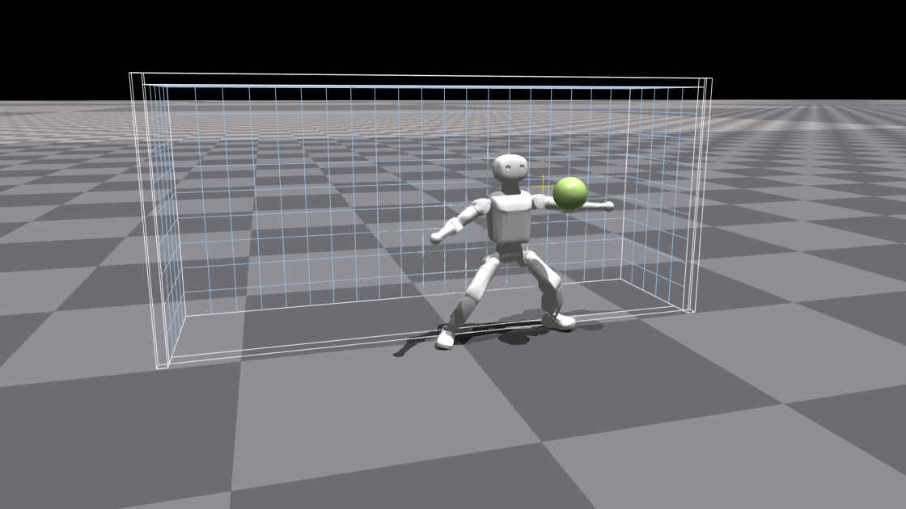
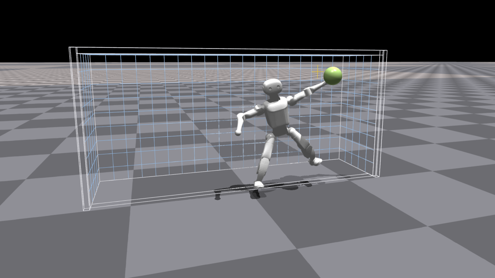
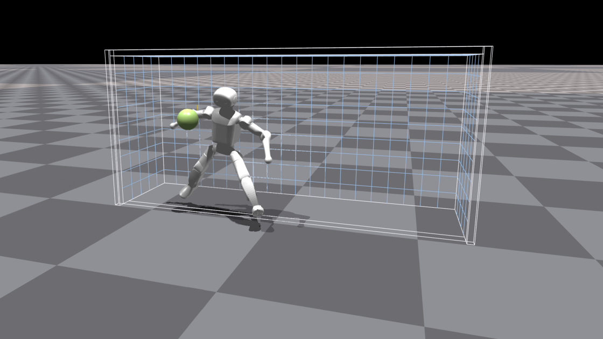

# Humanoid Goalkeeper for Booster K1

[Internship report](#internship-report) · [Simulation gallery](#simulation-gallery) · [References](#references) · [Upstream project website](https://humanoid-goalkeeper.github.io/Goalkeeper/) · [Original paper](https://arxiv.org/abs/2510.18002) · [ICHIRO ITS](https://ichiro-its.org/)

I prepared this adaptation for a research internship with ICHIRO, the humanoid robot soccer team at Institut Teknologi Sepuluh Nopember (ITS). The question behind the experiments was simple: how often can a simulated Booster K1 stop a shot and still finish on its feet?

The starting point was the Unitree G1 goalkeeper framework released by Junli Ren and colleagues. This repository documents the work specific to the 22-joint Booster K1: adapting the robot and ball configuration, generating shots, detecting goals, tuning the rewards for blocking and landing, and comparing policies on the same shots. All K1 results below come from NVIDIA Isaac Gym. [Original implementation](https://github.com/InternRobotics/Humanoid-Goalkeeper) · [K1 environment configuration](legged_gym/legged_gym/envs/k1/k1_config.py)

## Simulation gallery

Four verified standing saves from `landfix_5350` with the 15 cm (200 g) Size 1 ball and the 2.60 × 1.20 m goal frame, grouped by launch speed band.

### Standard speed range (`~5.5–9.0 m/s`, launch `3.0–4.4 m` · `81.02%` saves)

| Mid-left arm parry (`7.5 m/s` from `3.5 m`) | Low shin block (`8.0 m/s` from `3.5 m`) |
|:---:|:---:|
|  |  |
| Target `y = +0.45 m, z = 0.72 m` · standing two-foot save | Target `y = +0.05 m, z = 0.20 m` · standing two-foot save |

### High-speed range (`10–14 m/s`, launch `3.0–6.0 m` · `33.70%–40.83%` saves)

| High-corner overhead parry (`10.0 m/s` from `4.0 m`) | Fast right-side lateral parry (`12.0 m/s` from `5.0 m`) |
|:---:|:---:|
|  |  |
| Target `y = +0.65 m, z = 1.05 m` · standing two-foot save | Target `y = −0.60 m, z = 0.78 m` · standing save |

## Results

**The demo uses `landfix_5350`.** It saved 875 of 1,080 standard shots (81.02%). Across all shot speeds, including shots up to 14 m/s, it saved 2,076 of 4,312 on-target attempts (48.14%). Upper corners were harder: it stopped 568 of 1,432 (39.66%). The simulated goal measured 2.60 × 1.20 m. The ball weighed 200 g and measured 15 cm in diameter. [Ball model](legged_gym/resources/gymassets/urdf/ball_k1.urdf) · [Run G results](evaluation/k1_g_allseeds_benchmark.json)

| Checkpoint | Random saves / 4,312 on target | Upper-corner saves / 1,432 | Falls / 4,320 trials | Fixed-shot saves / 69 |
|---|---:|---:|---:|---:|
| `v9_5000` (baseline) | 1,931 (44.78%) | 414 | 70 | 28 |
| `nocollide_5200` (Run F) | 2,008 (46.57%) | 522 | 153 | 40 |
| **`landfix_5350` (Run G, demo)** | **2,076 (48.14%)** | **568** | 116 | **47** |
| `gema25_5400` (Run I, EMA ablation) | 2,079 (48.21%) | 532 | 93 | 46 |

Per-speed breakdown for **`landfix_5350`** across all three evaluation seeds (`1, 777, 2026`):

| Speed range | Launch distance | Saves / on-target shots | Save rate | Falls / 1,080 trials |
|---|---|---:|---:|---:|
| Standard (`~5.5–9.0 m/s`) | `3.0–4.4 m` | 875 / 1,080 | **81.02%** | **10** (0.93%) |
| Fast (`10 m/s`) | `3.0–4.4 m` | 396 / 1,072 | 36.94% | 38 (3.52%) |
| Fast (`12 m/s`) | `5.0 m` | 441 / 1,080 | 40.83% | 28 (2.59%) |
| Fast (`14 m/s`) | `6.0 m` | 364 / 1,080 | 33.70% | 40 (3.70%) |


The choice of demo policy came down to a trade-off. The two finalists finished three saves apart overall. For Run I relative to Run G, the estimated difference was +0.07 percentage points (paired 95% confidence interval −1.15 to +1.29). I selected `landfix_5350` for its 36 additional upper-corner saves. For studying balance, `gema25_5400` is a useful comparison: it fell 23 fewer times. [Run I results](evaluation/k1_i_allseeds_benchmark.json) · [Paired comparisons](evaluation/k1_i_paired_ci.json)

The random benchmark used evaluation seeds 1, 777, and 2026. A run without a goalkeeper identified the 4,312 shots that would have scored. The evaluator checked ball contact, goal crossing, and the final ball state. Falls use all 4,320 trials as their denominator. A separate set of 69 fixed shots covers sprint, between-the-legs, motion, and high-ball scenarios. Performance on a physical K1 and repeatability across training seeds remain open questions. [Outcome definitions](legged_gym/legged_gym/utils/shot_outcome.py)

## Internship report

The [working report](docs/run_e_results.md) contains the experimental setup, results tables, and notes for the write-up. The final internship PDF is pending. Its reserved location is `docs/k1-internship-report.pdf`.
<!-- When the final file is available, add [Download the internship report (PDF)](docs/k1-internship-report.pdf) to the opening link row. -->
<!-- Maintainer upload shortcut: https://github.com/bahyra26/Humanoid-Goalkeeper/upload/main/docs -->

## Installation

Use Linux, an NVIDIA GPU, and an Isaac Gym Preview installation compatible with Python 3.8. Follow NVIDIA's driver and PyTorch requirements for your Isaac Gym release. From the root of this K1 repository, replace the example Isaac Gym path with your local installation. [NVIDIA Isaac Gym](https://developer.nvidia.com/isaac-gym)

```bash
conda create -n goalkeeper python=3.8
conda activate goalkeeper
python -m pip install -e /path/to/isaacgym/python
python -m pip install -e ./rsl_rl -e ./legged_gym
python -m pip install -r requirements.txt
```

## Run the demo

The viewer loads local weights from `legged_gym/logs/k1/<experiment>/model_<iteration>.pt`. The K1 experiment checkpoints are stored outside Git. Place the matching checkpoint there before starting the viewer. The ball check runs without a GPU or checkpoint. [Demo launcher](play_k1_size1.sh)

```bash
./play_k1_size1.sh --check
./play_k1_size1.sh --exptid k1_v9_s1_landfix --checkpoint 5350
./play_k1_size1.sh --exptid k1_v9_s1_gema25 --checkpoint 5400
```

To launch from 3 m at 8 m/s, append `--start_x 3 --ball_speed 8`. Set `--target_y` and `--target_z` to aim at a particular point in metres. If the solver reports a minimum launch speed, move the launch point closer or increase the speed. The viewer requires an active graphical session.

## Train and evaluate

Use a fresh experiment ID for each run. The second command resumes from the selected checkpoint using the reward configuration in your checkout. Reproducing Run I requires its exponential-moving-average recovery reward with weight 25.

```bash
python legged_gym/legged_gym/scripts/train.py --task k1 --exptid k1_local_train --seed 1 --num_envs 1536 --headless
python legged_gym/legged_gym/scripts/train.py --task k1 --resume --resumeid k1_v9_s1_landfix --checkpoint 5350 --exptid k1_local_resume --seed 1 --max_iterations 50 --num_envs 1536 --headless
```

The paired benchmark needs the evaluation checkpoints passed via `--models` and the shot lists under `evaluation/`. The example writes to a separate results file. [Benchmark script](legged_gym/legged_gym/scripts/benchmark_k1.py)

```bash
python legged_gym/legged_gym/scripts/benchmark_k1.py --seeds 1 777 2026 \
  --models landfix_5350=legged_gym/logs/k1/k1_v9_s1_landfix/model_5350.pt \
           gema25_5400=legged_gym/logs/k1/k1_v9_s1_gema25/model_5400.pt \
  --output evaluation/local_comparison.json
python -m unittest discover -s tests -v
```

## Repository guide

| Topic | Where to look |
|---|---|
| Observations, actions, and rewards | [K1 configuration](legged_gym/legged_gym/envs/k1/k1_config.py) and [environment code](legged_gym/legged_gym/envs/base/legged_robot.py) |
| Reward calibration | [Calibration experiments](evaluation/K1_REWARD_CALIBRATION.md) |
| Shot lists and benchmark outputs | [Evaluation directory](evaluation/) |
| Underlying simulation and training libraries | [legged_gym](legged_gym/README.md) and [rsl_rl](rsl_rl/README.md) |

## References

1. **Humanoid Goalkeeper (upstream method & codebase):** Junli Ren, Junfeng Long, Tao Huang, Huayi Wang, Zirui Wang, Feiyu Jia, Wentao Zhang, Jingbo Wang, Ping Luo, and Jiangmiao Pang, *Humanoid Goalkeeper: Learning from Position Conditioned Task-Motion Constraints*, arXiv:2510.18002 (2025). [arXiv](https://arxiv.org/abs/2510.18002) · [Project website](https://humanoid-goalkeeper.github.io/Goalkeeper/) · [GitHub](https://github.com/InternRobotics/Humanoid-Goalkeeper)
2. **Dynamic Quadrupedal Robotic Goalkeeper (prior RL legged goalkeeping benchmark):** Xiaoyu Huang, Zhongyu Li, Yanzhen Xiang, Yiming Ni, Yufeng Chi, Yunhao Li, Lizhi Yang, Xue Bin Peng, and Koushil Sreenath, *Creating a Dynamic Quadrupedal Robotic Goalkeeper with Reinforcement Learning*, in *IEEE/RSJ International Conference on Intelligent Robots and Systems (IROS)*, 2023, arXiv:2210.04435. [arXiv](https://arxiv.org/abs/2210.04435)
3. **Legged Gym & RSL-RL (simulation environment & PPO library):** Nikita Rudin et al., Robotic Systems Lab, ETH Zurich, *Isaac Gym Environments for Legged Robots*, arXiv:2109.11978. [arXiv](https://arxiv.org/abs/2109.11978) · [Project website](https://leggedrobotics.github.io/legged_gym/) · [legged_gym](https://github.com/leggedrobotics/legged_gym) · [rsl_rl](https://github.com/leggedrobotics/rsl_rl)
4. **NVIDIA Isaac Gym (GPU physics simulation):** [NVIDIA Isaac Gym](https://developer.nvidia.com/isaac-gym)
5. **RoboCup Humanoid League Rules (2025) (KidSize goal & Size 1 ball specifications):** [Official Rules PDF](https://humanoid.robocup.org/wp-content/uploads/RC-HL-2025-Rules.pdf)
6. **ICHIRO ITS (internship host team):** [ICHIRO — Institut Teknologi Sepuluh Nopember](https://ichiro-its.org/)
<!-- Add additional papers, Booster K1 hardware/URDF references, or internship citations here. -->

## Citation and licensing

Credit the original method to Junli Ren, Junfeng Long, Tao Huang, Huayi Wang, Zirui Wang, Feiyu Jia, Wentao Zhang, Jingbo Wang, Ping Luo, and Jiangmiao Pang, *Humanoid Goalkeeper: Learning from Position Conditioned Task-Motion Constraints*, arXiv:2510.18002 (2025). When reporting a K1 result, also identify this adaptation, the repository revision, checkpoint, and evaluation seeds. [Original paper](https://arxiv.org/abs/2510.18002) · [Upstream source](https://github.com/InternRobotics/Humanoid-Goalkeeper)

The root license credits Junli Ren (2025) and specifies CC BY-NC-SA 4.0. For material it covers, retain attribution, identify modifications, link to the license, and follow its noncommercial and share-alike conditions. [Repository license](LICENSE) · [License summary](https://creativecommons.org/licenses/by-nc-sa/4.0/)

The bundled libraries and assets carry their own notices. Preserve the ETH Zurich, Nikita Rudin, and NVIDIA notices when redistributing their code. Check the terms for the specific robot meshes, motion datasets, and pretrained weights you intend to distribute. [legged_gym license](legged_gym/LICENSE) · [rsl_rl license](rsl_rl/LICENSE) · [ANYbotics asset license](legged_gym/resources/gymassets/urdf/anymal_b_simple_description/LICENSE) · [Fetch and Shadow Hand notices](legged_gym/resources/gymassets/mjcf/open_ai_assets/LICENSE.md)

For the upstream paper, its teaser, and the competition rules, use the publisher or project links rather than redistributing third-party PDFs; `docs/teaser.png` is inherited from the upstream repository. [Upstream project website](https://humanoid-goalkeeper.github.io/Goalkeeper/) · [RoboCup Humanoid League rules (2025)](https://humanoid.robocup.org/wp-content/uploads/RC-HL-2025-Rules.pdf)
