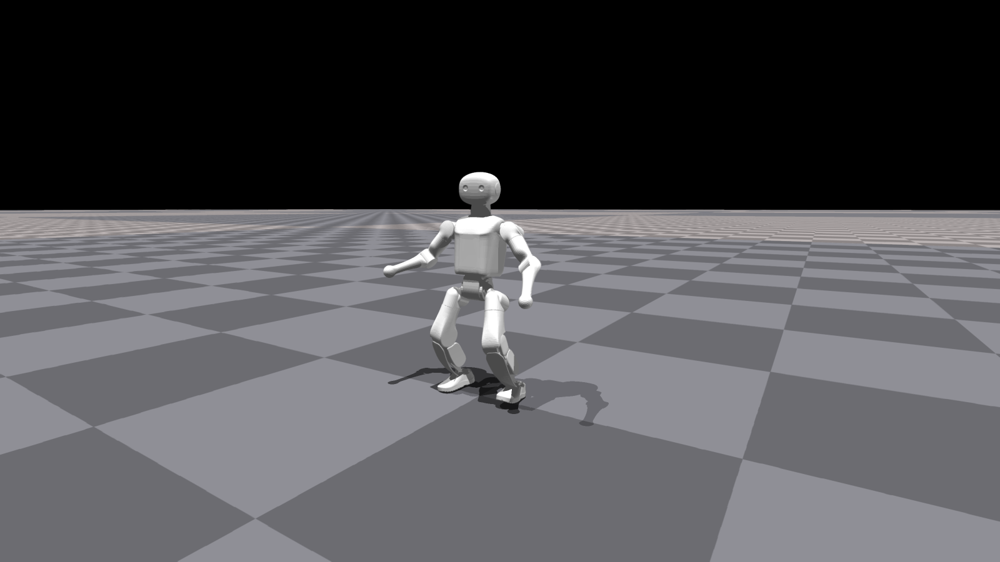

# Humanoid Goalkeeper — Booster K1 Adaptation (Work in Progress)

[](https://arxiv.org/abs/2510.18002)
[](https://humanoid-goalkeeper.github.io/Goalkeeper/)
[](https://github.com/InternRobotics/Goalkeeper)
[](#--current-status-limitations--roadmap-wip)
[](http://creativecommons.org/licenses/by-nc-sa/4.0/)
[](https://youtu.be/ZK0gPame19M)

> **Attribution & Source Notice:**  
> This repository is an ongoing adaptation built upon the official open-source implementation of **[Humanoid Goalkeeper: Learning from Position Conditioned Task-Motion Constraints](https://github.com/InternRobotics/Goalkeeper)** by **[Junli Ren](https://renjunli99.github.io/)\*, [Junfeng Long](https://junfeng-long.github.io/)\*, [Tao Huang](https://taohuang13.github.io/), [Huayi Wang](https://why618188.github.io/), [Zirui Wang](https://scholar.google.com/citations?user=Vc3DCUIAAAAJ&hl=zh-TW), [Feiyu Jia](https://trap-1.github.io/), [Wentao Zhang](https://zwt006.github.io/), [Jingbo Wang](https://wangjingbo1219.github.io/)†, [Ping Luo](https://luoping.me/)†, and [Jiangmiao Pang](https://oceanpang.github.io/)†** (*arXiv:2510.18002*).  
> While preserving full backward compatibility with the original **Unitree G1 (29-DOF)** AMP-based goalkeeper, this work adapts and calibrates the framework for the **Booster K1 (22-DOF RoboCup KidSize)** humanoid robot using pure Reinforcement Learning without human motion-capture priors.

> ⚠️ **Current Project Status (Work in Progress / Sementara):**  
> Pengembangan untuk **Booster K1** saat ini **masih berlangsung (belum selesai sepenuhnya)**. Pada tahap sekarang (`k1_v2`), perilaku yang berhasil dilatih baru berfokus pada **kemampuan dasar menepis/menyentuh bola saat kontak pertama (*first-contact ball parrying*)** ke 6 arah gawang. Robot **belum sampai pada tahap menghalangi/mengawal bola secara tuntas (*full goal-denial & post-contact ball containment*)** untuk memastikan bola yang sudah ditepis benar-benar berhenti total atau tidak bergulir masuk ke gawang, serta masih kadang tersandung bola yang jatuh di dekat kakinya sehabis menepis. Lihat bagian [Current Status, Limitations & Roadmap](#-current-status-limitations--roadmap-wip) di bawah untuk detailnya.

---

## 🥅 Booster K1 Goalkeeper Showcase (Simulation)

<p align="center">
  
  
</p>
<p align="center">
  
  
</p>
<p align="center">
  
  <br>
  <em>Booster K1 (22-DOF, 0.95 m, 19.67 kg) performing overhead jump parries, lateral arm sweeps, low crouch blocks, and maintaining its athletic ready stance in Isaac Gym.</em>
</p>

---

## ✨ Key Extensions for Booster K1 (`--task k1`)

Unlike the full-sized Unitree G1 (`--task 29`), the **Booster K1** is a compact **RoboCup KidSize** humanoid (`0.95 m` tall, `19.67 kg`, `22 DOF`) without pre-recorded human goalkeeper motion-capture datasets (`amp_coef = 0.0`). This adaptation introduces the following engineering and RL calibrations:

1. **RoboCup KidSize Physics & Asset Calibration**
   - **Ball Physics (`ball_k1.urdf`)**: Calibrated to RoboCup KidSize specifications (`radius = 0.10 m`, `mass = 0.40 kg`, solid sphere inertia $I = 0.00267\text{ kg}\cdot\text{m}^2$), while preserving the original `ball.urdf` for Unitree G1.
   - **K1 URDF & End-Effector Links (`k1.urdf`)**: Added dedicated `left_hand_link` and `right_hand_link` frames (`20 cm` distal from `elbow_yaw`) for accurate hand-to-ball tracking, and switched head/foot collision geometries to dedicated collision meshes (`Head_2_Collision.STL`, `Left_Foot_Collision.STL`, `Right_Foot_Collision.STL`).
   - **Parabolic Ballistic Shot Solver**: Computes exact ballistic trajectories (`assign_ball_states`) targeting the 6 zones of a **RoboCup KidSize goal (`2.6 m × 1.2 m`)** with `< 2.1 cm` vertical arrival error at the goal line (`x = 0.08 m`).

2. **Athletic Ready Stance & Differentiated PD / Action Scaling**
   - Configured a low-center-of-gravity goalkeeper stance (`z = 0.53 m`, `knee = 0.58 rad`, `ankle_pitch = -0.28 rad`, `hip_roll = ±0.10 rad`) with raised arms (`z ≈ 0.65 m`, midpoint of the `1.2 m` crossbar).
   - Stiffened shoulder (`Kp = 42.0`) and elbow (`Kp = 34.0`) PD gains with per-group action scaling (`arm_action_scale = 0.65`, `leg_action_scale = 0.35`, `head_action_scale = 0.40`) so the arms swing rapidly while the legs remain planted and stable.

3. **Anti-Reward-Hacking & Ground-Truth Parry Detection**
   - **Goal-Conceded Cancellation**: Explicitly tracks whether the ball crosses the goal plane (`x < -0.05 m`, `|y| < 1.35 m`, `z < 1.25 m`) via `goal_conceded_flag`, zeroing out false-positive save rewards when a goal is conceded.
   - **Velocity-Impulse & Trajectory Parry Verification**: Distinguishes genuine physical blocks ($\Delta v_x > 0.9\text{ m/s}$ or $\Delta v_{xy} > 1.2\text{ m/s}$ within `< 0.24 m` of the robot) and scales rewards between clean parries deflected outside the goal frame (`1.0x`) versus light grazes (`0.35x`), with a `1.5x` bonus for arm/hand saves.
   - **Goldilocks Reward Balance**: Calibrated `stopball = 450.0`, `eereach = 26.0` (with active hand closing-velocity bonus), `success = 16.0`, and `termination = -220.0` to eliminate both passive standing and suicidal diving.
   - **AMP Bypass Optimization**: Bypasses unused 6-skill AMP discriminators in `HIMPPO` and `HIMOnPolicyRunner` when `amp_coef <= 0`, reducing VRAM usage and reaching `~24,500 FPS` on a single laptop GPU.

---

## 📊 Booster K1 Evaluation Benchmark (`k1_v2`, Iter 3,400)

Evaluated across **472 randomized shots** spanning the full RoboCup KidSize goal (`2.6 m × 1.2 m`):

| Metric | Value | Notes |
| :--- | :---: | :--- |
| **True Save Rate** | **89.72%** | Physical saves where the ball never enters the goal |
| **Arm / Hand Save Rate** | **82.10%** | Saves executed directly with the hands/forearms |
| **Goal Conceded Rate** | **9.22%** | Shots that pass into the goal frame |
| **Post-Save Fall Rate** | **8.05%** | 91.95% of episodes remain upright through completion |
| **Mean Max Arm Swing** | **90.8° (`1.58 rad`)** | Active, high-velocity arm interception |
| **Mean Max Lateral Reach** | **52.1 cm** (max **191.4 cm**) | Dynamic sidestepping across the goal line |

**Save Rate by Goal Region (First-Contact Parry Evaluation):**
- **Region 0 (Mid-Left)**: `93.8%` (`76 / 81`)
- **Region 1 (Mid-Right)**: `90.0%` (`72 / 80`)
- **Region 2 (High-Left / Crossbar)**: `78.8%` (`63 / 80`)
- **Region 3 (High-Right / Crossbar)**: `85.0%` (`68 / 80`)
- **Region 4 (Low-Left / Ground)**: `88.8%` (`71 / 80`)
- **Region 5 (Low-Right / Ground)**: `88.8%` (`71 / 80`)

---

## 🚧 Current Status, Limitations & Roadmap (WIP)

Proyek adaptasi Booster K1 ini **masih bersifat sementara (*Work in Progress*)** dan belum mencapai tahap akhir. Berikut adalah batasan perilaku model saat ini (`k1_v2`) yang sedang dikerjakan untuk iterasi berikutnya:

1. **Baru Sebatas Menepis Kontak Pertama (*Parry-Only vs. True Goal Denial*)**
   - Saat ini, logika reward (`_reward_stopball` & `stop_flag = 1`) menilai tugas mengejar bola selesai begitu tangan/lengan robot berhasil melakukan kontak/tepisan pertama dengan bola.
   - Begitu `stop_flag` berubah menjadi `1`, input observasi posisi bola ke jaringan saraf robot langsung dinolkan (`flying = False`). Akibatnya, robot **belum memiliki kesadaran lanjutan untuk terus menghalangi/menahan bola** jika pantulan bola masih bergulir pelan menuju gawang.
2. **Interaksi Fisika Bola Jatuh & Tersandung Pasca-Tepis (*Post-Parry Stumbling*)**
   - Aset bola saat ini masih menggunakan *restitution* bawaan (`0.0`), sehingga bola yang ditepis di area depan-samping cenderung langsung jatuh ke tanah tepat di depan kaki robot, bukan memantul jauh.
   - Karena sensor bola dimatikan pasca-kontak pertama dan reward `feet_slippage` langsung menahan pergeseran telapak kaki, robot kadang **tersandung bola yang jatuh di dekat kakinya** atau kehilangan keseimbangan saat mengerem langkah samping.
3. **Target Pengembangan Selanjutnya (*Next Steps*)**
   - Menjaga observasi bola tetap aktif selama bola masih berada di depan garis gawang (`x > -0.05 m`) meskipun sudah disentuh sekali.
   - Mengubah fungsi objektif dari sekadar *first-contact parry* menjadi **full goal-line denial** (memastikan bola benar-benar terhenti `vx >= 0` atau terbuang keluar gawang, disertai penalti tegas jika bola tetap masuk ke gawang).
   - Menambahkan kalibrasi *restitution* bola serta fase *recovery step* agar robot dapat melangkah stabil sehabis menepis tanpa tersandung.

---

## 🛠️ Installation Instructions

1. **Clone the repository**
   ```bash
   git clone https://github.com/InternRobotics/Goalkeeper.git
   cd Goalkeeper
   ```

2. **Create and activate the Conda environment (Python 3.8)**
   ```bash
   conda create -n goalkeeper python=3.8
   conda activate goalkeeper
   ```

3. **Install [NVIDIA Isaac Gym](https://developer.nvidia.com/isaac-gym)**
   ```bash
   cd isaacgym/python && pip install -e . && cd ../..
   ```

4. **Install `rsl_rl`, `legged_gym`, and dependencies**
   ```bash
   cd rsl_rl && pip install -e . && cd ..
   cd legged_gym && pip install -e . && cd ..
   pip install -r requirements.txt
   ```

---

## ▶️ Usage Guide

### 1. Booster K1 Goalkeeper (`--task k1`)

**Train Booster K1 (Headless GPU):**
```bash
cd legged_gym/legged_gym/scripts
python train.py --task k1 --num_envs 2400 --exptid k1_v2 --headless
```

**Resume Training from Checkpoint:**
```bash
python train.py --task k1 --num_envs 2400 --exptid k1_v2 --resume --headless
```

**Visualize Trained Policy in 3D Viewer:**
```bash
cd legged_gym/legged_gym/scripts
python play_k1.py --exptid k1_v2
```

**Custom Ball Targeting & Shot Control in `play_k1.py` / `play.py`:**
You can manually aim shots at specific goal regions or exact $(Y, Z)$ coordinates on the goal line:
```bash
# Aim at a specific goal region (0: Mid-L, 1: Mid-R, 2: High-L, 3: High-R, 4: Low-L, 5: Low-R)
python play_k1.py --exptid k1_v2 --region 2

# Aim at exact goal-line coordinates (Y in [-1.3m, +1.3m], Z in [0.1m, 1.2m])
python play_k1.py --exptid k1_v2 --target_y 0.85 --target_z 1.05

# Customize shot flight time (e.g., 0.5s fast shot) with a single goalkeeper in the viewer
python play_k1.py --exptid k1_v2 --num_envs 1 --target_y -0.65 --target_z 0.55 --flight_time 0.55
```

**Inspect Booster K1 URDF & Ready Stance:**
```bash
python view_k1.py
```

---

### 2. Original Unitree G1 Goalkeeper (`--task 29`)

<p align="center">
  
</p>

All original Unitree G1 workflows remain fully supported:
```bash
cd legged_gym/legged_gym/scripts
# Train Unitree G1
python train.py --task 29 --exptid g1_gk

# Evaluate Unitree G1
python play.py --task 29 --exptid g1_gk
```

> **Note:** For a quick try on Unitree G1, reference checkpoints are available in `legged_gym/resources/weight/`.

---

## 🧰 Troubleshooting

- **`ImportError: libpython3.8.so.1.0: cannot open shared object file`**
  ```bash
  export LD_LIBRARY_PATH=$CONDA_PREFIX/lib:$LD_LIBRARY_PATH
  # Or copy to /usr/lib:
  sudo cp $CONDA_PREFIX/lib/libpython3.8.so.1.0 /usr/lib/
  ```
- **`Segmentation fault (core dumped)` when running `play.py` with `CUDA_VISIBLE_DEVICES=""`**
  - The Isaac Gym 3D viewer (`headless = False`) requires an active GPU CUDA context for OpenGL/Vulkan rendering. Run `play.py` / `play_k1.py` **without** `CUDA_VISIBLE_DEVICES=""`.
- **`CUDA out of memory`**
  - Reduce `--num_envs` (e.g., `--num_envs 1536` or `--num_envs 1200` on 6 GB VRAM laptops).

---

## 📚 Credits, Sources & Citation

This project builds upon the following open-source works. Please cite the original paper when using this repository in academic or research settings:

1. **Upstream Framework & Methodology**:  
   *Humanoid Goalkeeper: Learning from Position Conditioned Task-Motion Constraints* — [InternRobotics/Goalkeeper](https://github.com/InternRobotics/Goalkeeper) ([Project Page](https://humanoid-goalkeeper.github.io/Goalkeeper/), [arXiv:2510.18002](https://arxiv.org/abs/2510.18002)).  
   For questions regarding the original paper, please contact **junlir@connect.hku.hk**.
2. **Simulation Base**:  
   [legged_gym](https://github.com/leggedrobotics/legged_gym) and [rsl_rl](https://github.com/leggedrobotics/rsl_rl) by ETH Zurich Robotic Systems Lab & NVIDIA Isaac Gym.
3. **Robot Models**:  
    Booster K1 URDF & meshes by **Booster Robotics**; Unitree G1 URDF & meshes by **Unitree Robotics**.

```bibtex
@article{ren2025humanoidgoalkeeper,
  title={Humanoid Goalkeeper: Learning from Position Conditioned Task-Motion Constraints},
  author={Ren, Junli and Long, Junfeng and Huang, Tao and Wang, Huayi and Wang, Zirui and Jia, Feiyu and Zhang, Wentao and Wang, Jingbo and Luo, Ping and Pang, Jiangmiao},
  journal={arXiv preprint arXiv:2510.18002},
  year={2025}
}
```

---

## 📄 License

This project inherits the license of the original upstream repository and is licensed under the <a rel="license" href="http://creativecommons.org/licenses/by-nc-sa/4.0/">CC BY-NC-SA 4.0 International License</a> <a rel="license" href="http://creativecommons.org/licenses/by-nc-sa/4.0/"></a>.  
Commercial use is not allowed without explicit authorization from the original authors.
