# Humanoid Goalkeeper for Booster K1

[Internship report](#internship-report) · [Simulation gallery](#simulation-gallery) · [References](#references) · [Upstream project website](https://humanoid-goalkeeper.github.io/Goalkeeper/) · [Original paper](https://arxiv.org/abs/2510.18002) · [ICHIRO ITS](https://ichiro-its.org/)

I prepared this adaptation for a research internship with ICHIRO, the humanoid robot soccer team at Institut Teknologi Sepuluh Nopember (ITS). The question behind the experiments was simple: how often can a simulated Booster K1 stop a shot and still finish on its feet?

The starting point was the Unitree G1 goalkeeper framework released by Junli Ren and colleagues. This repository documents the work specific to the 22-joint Booster K1: adapting the robot and ball configuration, generating shots, detecting goals, tuning rewards for balanced blocking and safe upper-body limits, adding a dedicated Policy 2 walk-back controller (`k1_walk`), and comparing policies on identical shots. All K1 results below come from NVIDIA Isaac Gym. [Original implementation](https://github.com/InternRobotics/Humanoid-Goalkeeper) · [K1 environment configuration](legged_gym/legged_gym/envs/k1/k1_config.py) · [Two-policy controller](legged_gym/legged_gym/utils/k1_two_policy.py)

## Simulation gallery

Four verified standing saves from the final 2-policy release (`v11_6000 + walk_v5_2700`) with the 15 cm (200 g) Size 1 ball and the 2.60 × 1.20 m goal frame, grouped by launch speed band.

### Standard speed range (`~5.5–9.0 m/s`, launch `3.0–4.4 m` · `82.96%` final / `81.02%` Run G)

| Mid-left shoulder parry (`7.5 m/s` from `3.5 m`) | Low shin block (`8.0 m/s` from `3.5 m`) |
|:---:|:---:|
|  | 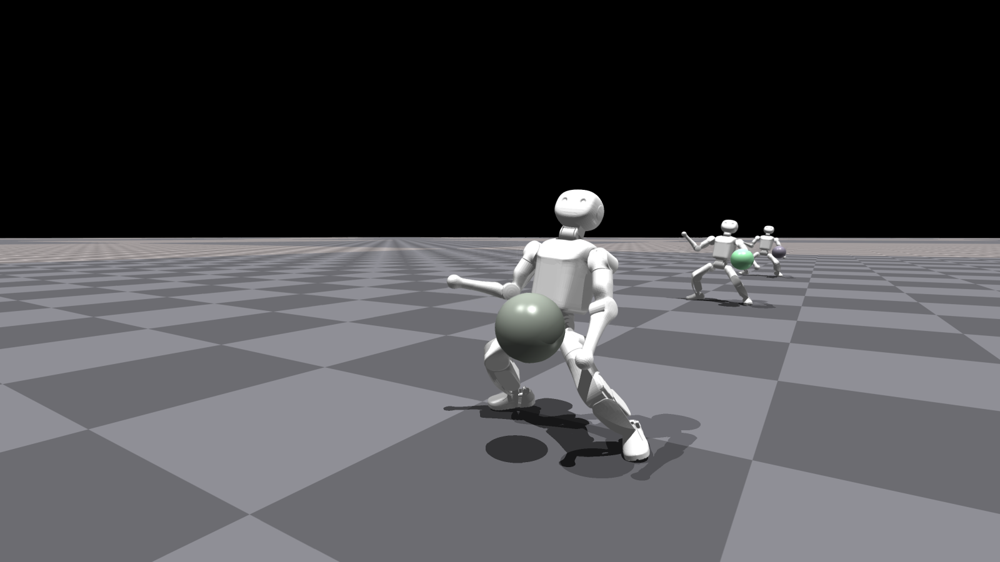 |
| Target `y = +0.45 m, z = 0.72 m` · standing two-foot save | Target `y = +0.05 m, z = 0.20 m` · standing two-foot save |

### High-speed range (`10–14 m/s`, launch `3.0–6.0 m` · `39.27%–42.59%` final / `33.70%–40.83%` Run G)

| High-corner left-arm parry (`10.0 m/s` from `4.0 m`) | Fast right-side lateral parry (`12.0 m/s` from `5.0 m`) |
|:---:|:---:|
|  |  |
| Target `y = +0.55 m, z = 0.95 m` · standing save | Target `y = −0.60 m, z = 0.78 m` · standing save |

### Kicker-POV animated clips (`60 fps`, `1.0x` real-time)

All 15 raw clips below are recorded from behind the kicker (`960x540` single clips, `800x450` continuous sequence) with `v11_6000 + walk_v5_2700`.

#### Standard speed across all 6 goal regions (`7.0–8.5 m/s`)

| `R0` Mid-Left (`7.0 m/s` from `3.4 m`) | `R1` Mid-Right (`7.5 m/s` from `3.5 m`) | `R2` High-Left (`8.5 m/s` from `4.2 m`) |
|:---:|:---:|:---:|
| 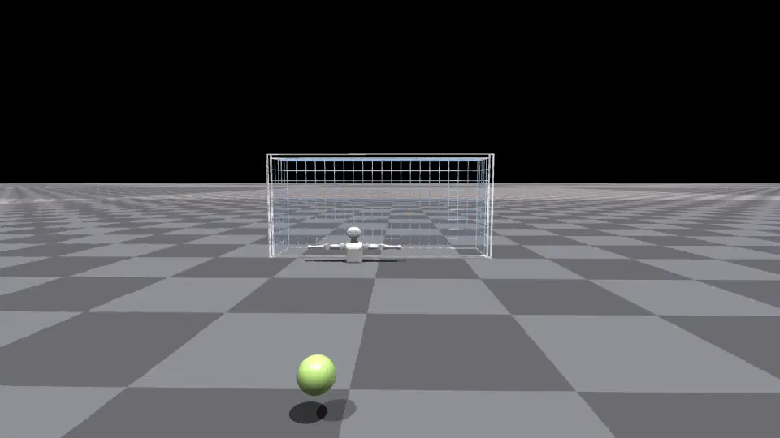 | 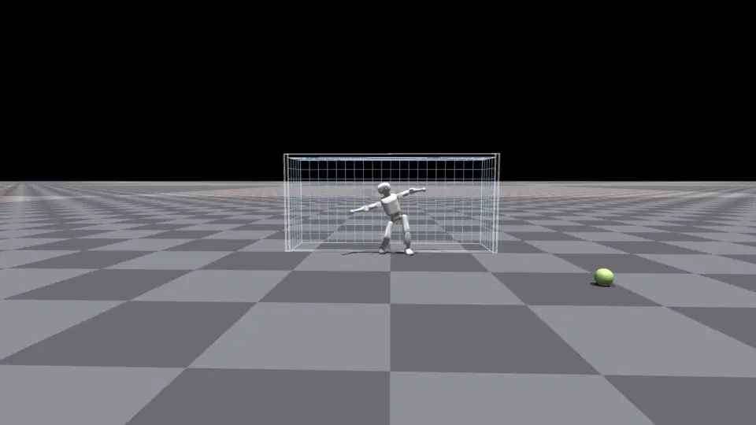 | 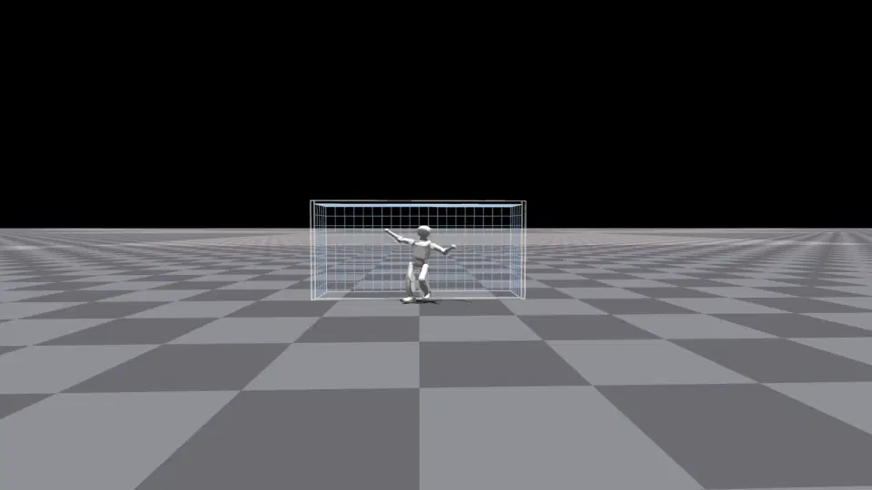 |
| Target `y = +0.35 m, z = 0.55 m` | Target `y = −0.45 m, z = 0.62 m` | Target `y = +0.60 m, z = 0.98 m` |

| `R3` High-Right (`7.8 m/s` from `3.8 m`) | `R4` Low-Left (`7.8 m/s` from `3.7 m`) | `R5` Low-Right (`7.5 m/s` from `3.5 m`) |
|:---:|:---:|:---:|
| 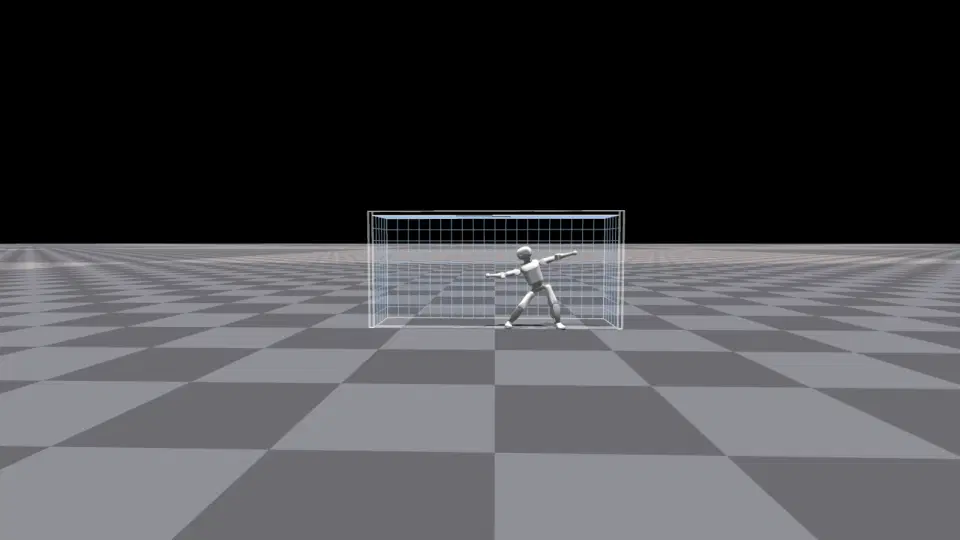 | 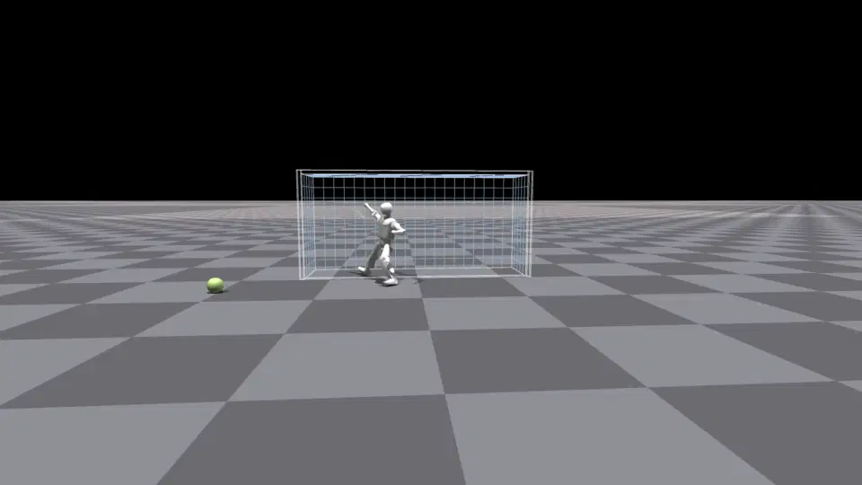 | 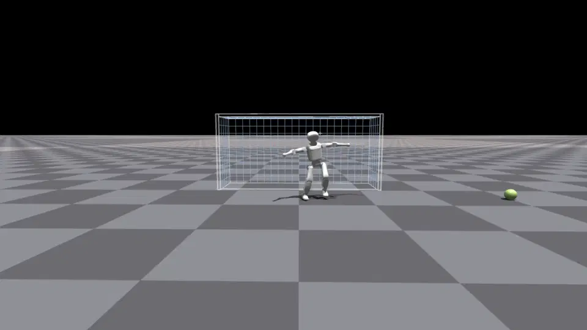 |
| Target `y = −0.45 m, z = 0.85 m` | Target `y = +0.45 m, z = 0.22 m` | Target `y = −0.25 m, z = 0.20 m` |

#### High speed across all 6 goal regions (`10.5–12.0 m/s`)

| `R0` Mid-Left (`10.5 m/s` from `4.2 m`) | `R1` Mid-Right (`11.0 m/s` from `4.5 m`) | `R2` High-Left (`11.0 m/s` from `4.6 m`) |
|:---:|:---:|:---:|
| 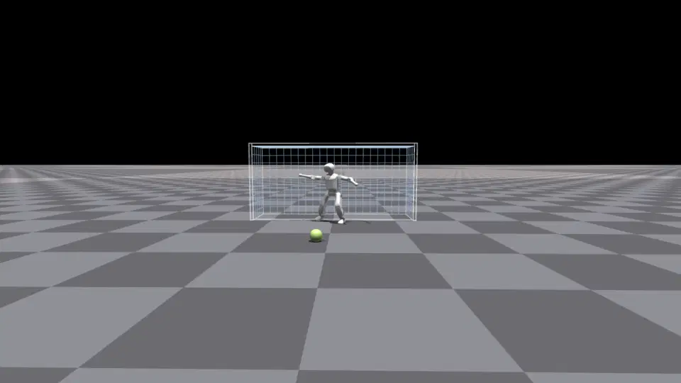 | 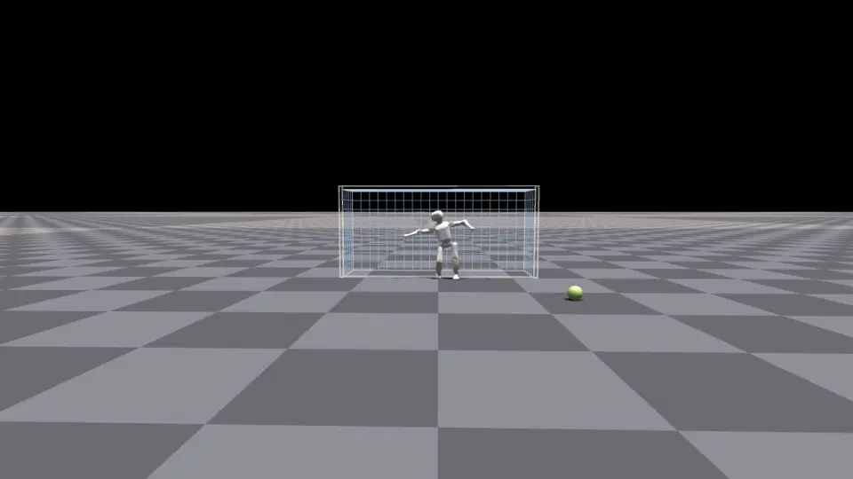 | 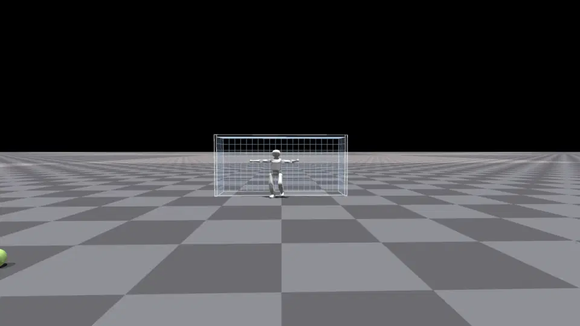 |
| Target `y = +0.35 m, z = 0.55 m` | Target `y = −0.45 m, z = 0.65 m` | Target `y = +0.50 m, z = 0.95 m` |

| `R3` High-Right (`12.0 m/s` from `4.5 m`) | `R4` Low-Left (`12.0 m/s` from `5.0 m`) | `R5` Low-Right (`10.5 m/s` from `4.4 m`) |
|:---:|:---:|:---:|
| 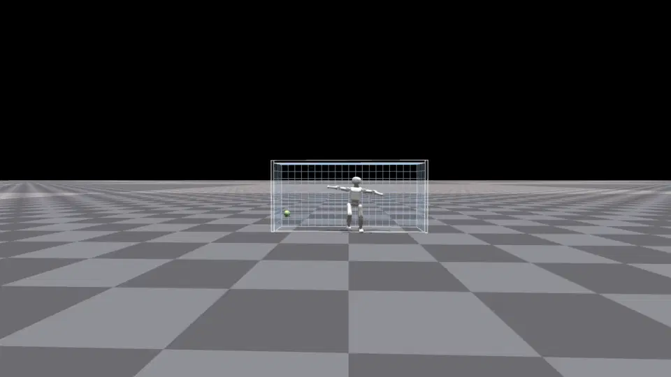 | 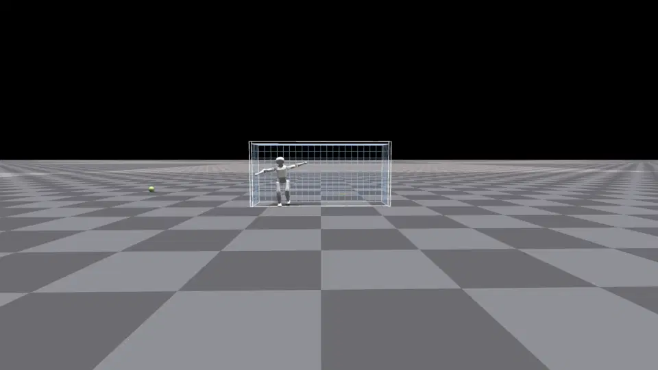 | 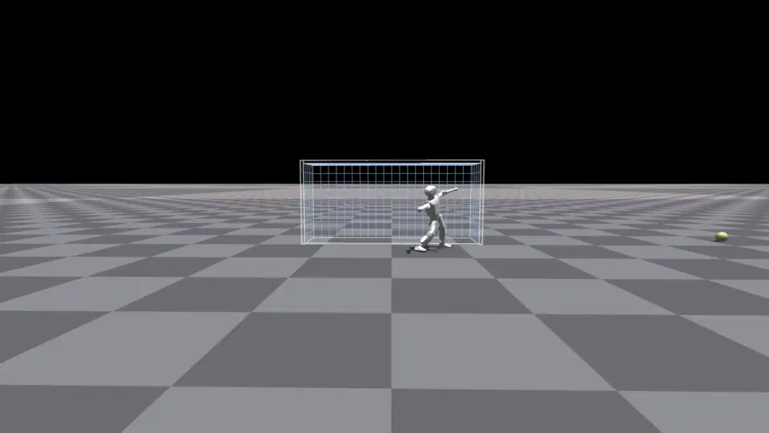 |
| Target `y = −0.65 m, z = 1.12 m` | Target `y = +0.45 m, z = 0.24 m` | Target `y = −0.30 m, z = 0.22 m` |

#### Two-policy walk-back and 5-shot continuous sequence

| 2-Policy Walk-Back (`R2` `11.0 m/s` → `READY_HOME`) | 2-Policy Walk-Back (`R1` `11.0 m/s` → `READY_HOME`) | 5-Shot Continuous (`R4 → R5 → R2 → R3 → R1`) |
|:---:|:---:|:---:|
| 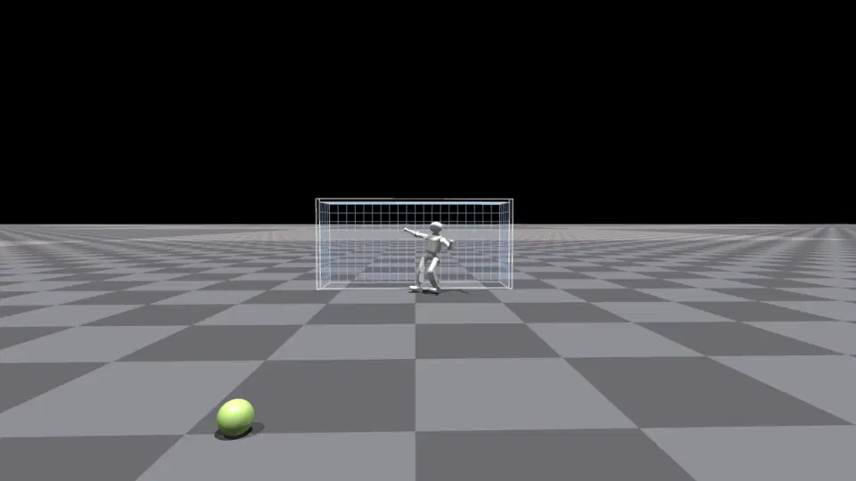 | 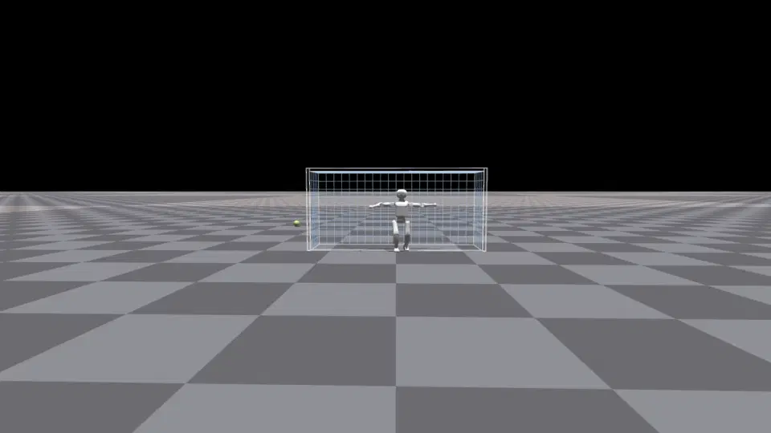 | 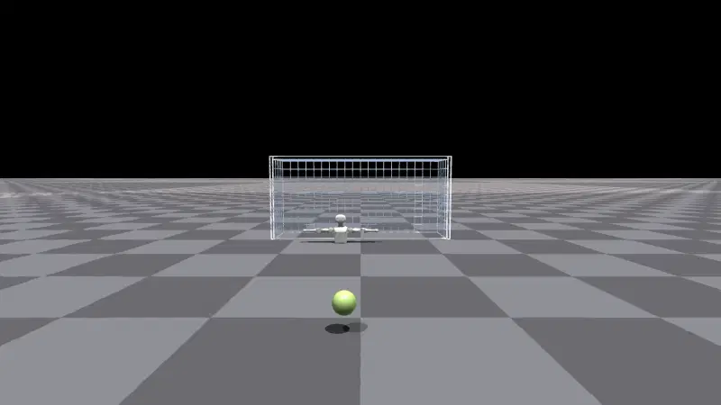 |
| `3.8 s` full save-and-return cycle | `4.8 s` full save-and-return cycle | `7.5 / 7.5 / 11.0 / 7.8 / 11.0 m/s` (`5/5` saves) |

## Results

**The final demo uses the 2-policy pair `v11_6000 + walk_v5_2700`.** Evaluated under the **`70/30` training-matched shot mix** (`70%` standard `~5.5–9.0 m/s` + `30%` fast `10–14 m/s`, matching `train_fast_ratio = 0.30` across seeds `1, 777, 2026`), `v11_6000` achieves a **`70.23%` weighted save rate** (`82.96%` on `1,080` standard shots with only `7` falls, and `40.53%` across `3,232` fast `10–14 m/s` shots; `+2.37` pp over Run G `landfix_5350` at `67.86%`). On the unweighted equal-band stress test (`25%` standard / `75%` fast `10–14 m/s`, `4,312` on-target shots), it saves **2,206 / 4,312 (`51.16%`, `+130` saves over Run G)**. It enforces `0.0%` upper-body PD target overshoot beyond URDF hard stops (`limit_targets_upper_only = True`), closes the standing five-hole (*kolong*) inner foot gap from `18.7 cm` to `14.6 cm` (`< 15.0 cm` Size 1 ball), and hands off after ball clearance to Policy 2 (`k1_walk_v5/model_2700.pt`) to walk back calmly to goal center. The simulated goal measured `2.60 × 1.20 m`, and the Size 1 ball weighed `200 g` (`15 cm` diameter). [Ball model](legged_gym/resources/gymassets/urdf/ball_k1.urdf) · [Final 3-seed results](evaluation/k1_v11_v13_allseeds_benchmark.json) · [Run G results](evaluation/k1_g_allseeds_benchmark.json) · [Checkpoint manifest](evaluation/FINAL_CHECKPOINTS.json)

| Checkpoint | `70/30` save rate (`70%` STD / `30%` Fast) | `STD` (`~5.5–9 m/s`) | Fast (`10–14 m/s`) | Stress `25/25/25/25` (/ 4,312) | Upper corners (/ 1,432) | `STD` falls (/ 1,080) | Fixed (/ 69) |
|---|---:|---:|---:|---:|---:|---:|---:|
| `v9_5000` (baseline) | 64.02% | 76.85% | 34.07% | 1,931 (44.78%) | 414 (28.91%) | 7 | 28 |
| `nocollide_5200` (Run F) | 66.56% | 79.91% | 35.43% | 2,008 (46.57%) | 522 (36.45%) | 30 | 40 |
| `landfix_5350` (Run G, `--legacy`) | 67.86% | 81.02% | 37.16% | 2,076 (48.14%) | 568 (39.66%) | 10 | **47** |
| `gema25_5400` (Run I, EMA ablation) | 68.44% | 81.94% | 36.94% | 2,079 (48.21%) | 532 (37.15%) | 7 | 46 |
| **`v11_6000` (Final balanced, default demo)** | **70.23%** | **82.96%** | **40.53%** | **2,206 (51.16%)** | 524 (36.59%) | **7** | 39 |
| `v13_5800` (Agile high-corner specialist) | 64.03% | 76.76% | 34.31% | 1,938 (44.94%) | **573 (40.01%)** | 62 | 44 |

Per-speed breakdown for the final policy **`v11_6000`** vs legacy **`landfix_5350`** across all three evaluation seeds (`1, 777, 2026`):

| Speed tier | Launch distance | `v11_6000` saves | `v11_6000` rate | `landfix_5350` rate | Gain (`v11` vs Run G) |
|---|---|---:|---:|---:|---:|
| **`70/30` weighted overall (`70%` STD + `30%` Fast)** | `3.0–6.0 m` | weighted | **70.23%** | 67.86% | **`+2.37 pp`** |
| Standard (`~5.5–9.0 m/s`) | `3.0–4.4 m` | **896 / 1,080** | **82.96%** | 81.02% | `+21` (`+1.94%`) |
| Fast combined (`10–14 m/s`) | `3.0–6.0 m` | **1,310 / 3,232** | **40.53%** | 37.16% | `+109` (`+3.37%`) |
| Fast (`10 m/s`) | `3.0–4.4 m` | **421 / 1,072** | **39.27%** | 36.94% | `+25` (`+2.33%`) |
| Fast (`12 m/s`) | `5.0 m` | **460 / 1,080** | **42.59%** | 40.83% | `+19` (`+1.76%`) |
| Fast (`14 m/s`) | `6.0 m` | **429 / 1,080** | **39.72%** | 33.70% | `+65` (`+6.02%`) |

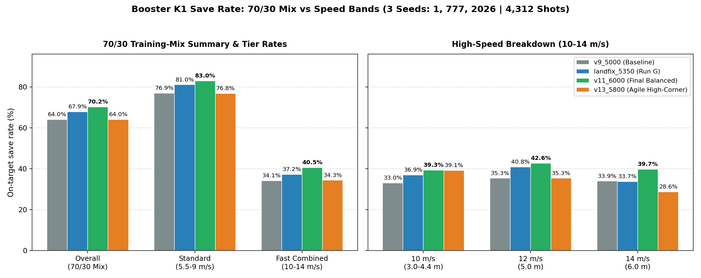

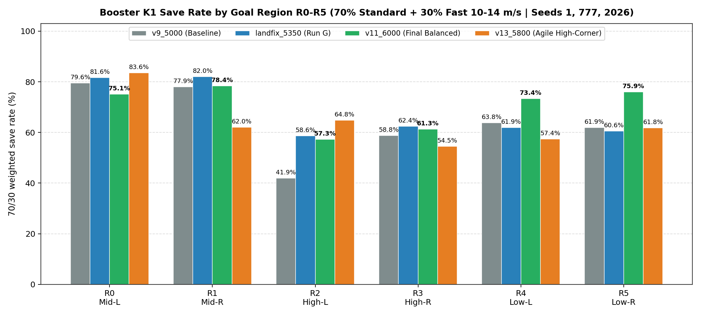

The earlier Run G vs Run I comparison (`landfix_5350` vs `gema25_5400`, difference `+0.07` percentage points, paired 95% CI `−1.15` to `+1.29`) established `landfix_5350` as the parent checkpoint for the balanced and agile fine-tuning stages below. [Run I results](evaluation/k1_i_allseeds_benchmark.json) · [Paired comparisons](evaluation/k1_i_paired_ci.json)

The random benchmark used evaluation seeds 1, 777, and 2026. A run without a goalkeeper identified the 4,312 shots that would have scored. The evaluator checked ball contact, goal crossing, and the final ball state. Falls use all 4,320 trials as their denominator. A separate set of 69 fixed shots covers sprint, between-the-legs, motion, and high-ball scenarios. Performance on a physical K1 and repeatability across training seeds remain open questions. [Outcome definitions](legged_gym/legged_gym/utils/shot_outcome.py)

### Two-policy walk-back, balanced speeds, and joint-limit updates

Follow-up work after Run G/I addressed five practical issues observed in simulation: post-parry jitter/drifting, slow-vs-fast shot balance, upper-corner joint-limit overshoot, standing five-hole (*kolong*) gaps, and jump aggressiveness.

- **Two-policy architecture (`Policy 1 + Policy 2`):** [k1_two_policy.py](legged_gym/legged_gym/utils/k1_two_policy.py) keeps Policy 1 (`k1`) active during incoming shots and live rebounds. Once the ball is strictly cleared for `0.24 s`, a 6-step linear blend hands control to Policy 2 (`k1_walk`, trained with `WalkActorCritic` and `10,151` recorded post-parry landing states in [k1_walk.py](legged_gym/legged_gym/envs/k1/k1_walk.py)) to stabilize upright and walk back to `(0, 0, yaw = 0)` (`READY_HOME`). Any re-approaching shot preempts back to Policy 1 immediately.
- **70/30 speed mix and symmetric corner/low shots:** [k1_config.py](legged_gym/legged_gym/envs/k1/k1_config.py) sets `train_fast_ratio = 0.30` (`70%` standard, `30%` fast `[8.5, 14.0] m/s`), `train_kolong_ratio = 0.30` across both slow and fast low shots, and `train_high_corner_ratio = 0.50` across `R2/R3`.
- **Upper-body joint-target guard (`limit_targets_upper_only = True`):** PD position targets for all 10 arm and head joints are clamped to URDF mechanical limits (`0.0%` target overshoot), while leg targets remain unclamped so explosive jump takeoff and lateral push-off are preserved.
- **Anti-kolong ready stance:** narrowing `hip_roll = ±0.04` and `ankle_roll = ∓0.04` closes the initial standing inner foot gap from `18.7 cm` (`> 15.0 cm` ball) to `14.6 cm` (`< 15.0 cm` ball), with a tightened `0.20 m` center-gap threshold in `_reward_kolong_gap`.

Head-to-head comparison across all three evaluation seeds (`1, 777, 2026`: `4,312` on-target random shots across `4,320` trials, plus `69` fixed shots) and `12 s` 2-policy E2E evaluation (`120` `STD` + `120` `12 m/s @ 5 m` shots on `seed 1`), each evaluated in its native configuration ([Run G 3-seed benchmark](evaluation/k1_g_allseeds_benchmark.json) · [v11/v13 3-seed benchmark](evaluation/k1_v11_v13_allseeds_benchmark.json) · [2-policy E2E verification](evaluation/k1_walk_v6_e2e.json)):

| Metric | Legacy (`landfix_5350 + walk_v4_2400`, `--legacy`) | Balanced (`v11_6000 + walk_v5_2700`, recommended) | Agile (`v13_5800 + walk_v5_2700`) |
| --- | :---: | :---: | :---: |
| Standard (`STD`) saves / `1,080` (`3` seeds) | `875` (`81.02%`, `10` falls) | **`896` (`82.96%`, `7` falls)** | `829` (`76.76%`, `62` falls) |
| Fast `10 m/s` saves / `1,072` (`3` seeds) | `396` (`36.94%`) | **`421` (`39.27%`)** | `419` (`39.09%`) |
| Fast `12 m/s @ 5 m` saves / `1,080` (`3` seeds) | `441` (`40.83%`) | **`460` (`42.59%`)** | `381` (`35.28%`) |
| Fast `14 m/s @ 6 m` saves / `1,080` (`3` seeds) | `364` (`33.70%`) | **`429` (`39.72%`)** | `309` (`28.61%`) |
| **`70/30` weighted save rate (`70%` STD + `30%` Fast)** | `67.86%` | **`70.23%` (`+2.37` pp)** | `64.03%` |
| Total stress saves / `4,312` (`25/25/25/25`) | `2,076` (`48.14%`) | **`2,206` (`51.16%`, `+130` saves)** | `1,938` (`44.94%`) |
| Upper-corner (`R2+R3`) saves / `1,432` (`3` seeds) | `568` (`39.66%`) | `524` (`36.59%`) | **`573` (`40.01%`)** |
| Fixed-shot saves (`S1` / `KOL` / `MOT` / `HI`) | **`18/18`** · **`9/12`** · `7/9` · **`13/30`** (`47/69`) | `16/18` · `6/12` · **`9/9`** · `8/30` (`39/69`) | `16/18` · `8/12` · **`9/9`** · `11/30` (`44/69`) |
| Upper-body PD target `> hard` URDF | up to `33.1%` | **`0.0%`** | **`0.0%`** |
| Standing inner foot gap (`15.0 cm` ball) | `18.7 cm` | **`14.6 cm`** | **`14.6 cm`** |
| 2-policy E2E falls (`STD` / `12 m/s`, `12 s`) | **`0/120`** / `3/120` (`p2 = 0`) | `2/120` / `8/120` (`p2 = 2 / 2`) | **`0/120`** / **`1/120`** (`p2 = 0 / 1`) |
| 2-policy E2E `HOME` (`240` shots) & jitter `\|da\|` | `234/240` · `0.0013–0.0014` | `230/240` · `0.0012` | **`238/240`** · **`0.0011`** |

`v11_6000 + walk_v5_2700` is the recommended general-purpose pair: across `4,312` on-target shots (`seeds 1, 777, 2026`), it achieves **`70.23%`** under the `70/30` training-matched mix (`51.16%` = `2,206 / 4,312` on the 4-band stress test, `+130` saves over `landfix_5350`), wins at every speed band (`82.96%` `STD` with only `7 / 1,080` falls, `39.27%` at `10 m/s`, `42.59%` at `12 m/s`, `39.72%` at `14 m/s`), guarantees `0.0%` upper-body target overshoot, and maintains an anti-kolong `14.6 cm` standing gap. `v13_5800 + walk_v5_2700` is the specialist for aggressive upper-corner leaps (`573 / 1,432 = 40.01%` upper-corner saves, `11/30` on `HIGH_GRID_30`, and `238/240` `HOME` with `1` Policy 2 fall in 2-policy E2E) at a lower overall save rate (`64.03%` `70/30`, `44.94%` stress).

A re-polish of Policy 2 under the final guard (`k1_walk_v6`, `300` iterations from `walk_v5_2700`, [verification](evaluation/k1_walk_v6_e2e.json)) lowered standing jitter (`|da| 0.0007–0.0008` vs `0.0011–0.0012`) while keeping `1–7` Policy 2 falls (`227–235/240` `HOME`), within simulation noise of `walk_v5_2700` (`1–4` Policy 2 falls, `230–238/240` `HOME`), so `walk_v5_2700` remains the recommended Policy 2.

## Internship report

The [working report](docs/run_e_results.md) contains the experimental setup, results tables, and notes for the write-up. The final internship PDF is pending. Its reserved location is `docs/k1-internship-report.pdf`.
<!-- When the final file is available, add [Download the internship report (PDF)](docs/k1-internship-report.pdf) to the opening link row. -->
<!-- Maintainer upload shortcut: https://github.com/bahyra26/Humanoid-Goalkeeper/upload/main/docs -->

## Installation

Use Linux, an NVIDIA GPU, and an Isaac Gym Preview installation compatible with Python 3.8. Follow NVIDIA's driver and PyTorch requirements for your Isaac Gym release. From the root of this K1 repository, replace the example Isaac Gym path with your local installation. [NVIDIA Isaac Gym](https://developer.nvidia.com/isaac-gym)

```bash
conda create -n goalkeeper python=3.8
conda activate goalkeeper
python -m pip install -e /path/to/isaacgym/python
python -m pip install -e ./rsl_rl -e ./legged_gym
python -m pip install -r requirements.txt
```

## Run the demo

The viewer loads local weights from `legged_gym/logs/k1/<experiment>/model_<iteration>.pt`. The K1 experiment checkpoints are stored outside Git. Place the matching checkpoint there before starting the viewer. The ball check runs without a GPU or checkpoint. [Demo launcher](play_k1_size1.sh)

```bash
./play_k1_size1.sh --check
# Default final 2-policy balanced demo (auto-loads v11_6000 + walk_v5_2700 when present):
./play_k1_size1.sh
# Same final demo with fast 12 m/s shots from 5 m (same --seed for paired comparison):
./play_k1_size1.sh --ball_speed 12 --start_x 5 --seed 100
# Aggressive upper-corner leap variant (v13_5800 + walk_v5_2700):
./play_k1_size1.sh --exptid k1_v13_agile --checkpoint 5800 --ball_speed 12 --start_x 5 --seed 100
# Legacy Run G baseline in its original stance (hip/ankle roll ±0.10, no target clamp, auto-loads walk_v4_2400):
./play_k1_size1.sh --legacy --ball_speed 12 --start_x 5 --seed 100
```

Omit `--ball_speed 12 --start_x 5` for standard-speed (`STD`) shots, or pass `--walk_ckpt ""` to disable Policy 2 walk-back. Set `--target_y` and `--target_z` to aim at a specific point in metres, or use viewer hotkeys (`F`/`G` speed, `0..5` region, `6` random, `Q`/`E` distance, `R`/`Enter` re-shoot). Use `--legacy` whenever replaying checkpoints trained before the `±0.04` anti-kolong stance and target-clamp update. The viewer requires an active graphical session.

## Train and evaluate

Use a fresh experiment ID for each run. The second command resumes from the selected checkpoint using the reward configuration in your checkout; the third trains the Policy 2 walk-back controller (`k1_walk`).

```bash
python legged_gym/legged_gym/scripts/train.py --task k1 --exptid k1_local_train --seed 1 --num_envs 1536 --headless
python legged_gym/legged_gym/scripts/train.py --task k1 --resume --resumeid k1_v9_s1_landfix --checkpoint 5350 --exptid k1_local_resume --seed 1 --max_iterations 300 --num_envs 1536 --headless
python legged_gym/legged_gym/scripts/train.py --task k1_walk --exptid k1_walk_local --seed 1 --num_envs 2048 --headless
```

The paired benchmark needs the evaluation checkpoints passed via `--models` and the shot lists under `evaluation/`. The example writes to a separate results file. [Benchmark script](legged_gym/legged_gym/scripts/benchmark_k1.py)

```bash
python legged_gym/legged_gym/scripts/benchmark_k1.py --seeds 1 777 2026 \
  --models v11_6000=legged_gym/logs/k1/k1_v11_balanced_p2/model_6000.pt \
           v13_5800=legged_gym/logs/k1/k1_v13_agile/model_5800.pt \
  --output evaluation/local_comparison.json
python -m unittest discover -s tests -v
```

## Repository guide

| Topic | Where to look |
|---|---|
| Observations, actions, and rewards | [K1 configuration](legged_gym/legged_gym/envs/k1/k1_config.py) and [environment code](legged_gym/legged_gym/envs/base/legged_robot.py) |
| Two-policy walk-back & handover | [Walk environment](legged_gym/legged_gym/envs/k1/k1_walk.py), [walk config](legged_gym/legged_gym/envs/k1/k1_walk_config.py), and [state machine](legged_gym/legged_gym/utils/k1_two_policy.py) |
| Unit tests (`74` tests) | [Tests directory](tests/) (including [2-policy tests](tests/test_k1_two_policy.py) and [target guard tests](tests/test_joint_target_guard.py)) |
| Reward calibration | [Calibration experiments](evaluation/K1_REWARD_CALIBRATION.md) |
| Shot lists and benchmark outputs | [Evaluation directory](evaluation/) |
| Underlying simulation and training libraries | [legged_gym](legged_gym/README.md) and [rsl_rl](rsl_rl/README.md) |

## References

1. **Humanoid Goalkeeper (upstream method & codebase):** Junli Ren, Junfeng Long, Tao Huang, Huayi Wang, Zirui Wang, Feiyu Jia, Wentao Zhang, Jingbo Wang, Ping Luo, and Jiangmiao Pang, *Humanoid Goalkeeper: Learning from Position Conditioned Task-Motion Constraints*, arXiv:2510.18002 (2025). [arXiv](https://arxiv.org/abs/2510.18002) · [Project website](https://humanoid-goalkeeper.github.io/Goalkeeper/) · [GitHub](https://github.com/InternRobotics/Humanoid-Goalkeeper)
2. **Dynamic Quadrupedal Robotic Goalkeeper (prior RL legged goalkeeping benchmark):** Xiaoyu Huang, Zhongyu Li, Yanzhen Xiang, Yiming Ni, Yufeng Chi, Yunhao Li, Lizhi Yang, Xue Bin Peng, and Koushil Sreenath, *Creating a Dynamic Quadrupedal Robotic Goalkeeper with Reinforcement Learning*, in *IEEE/RSJ International Conference on Intelligent Robots and Systems (IROS)*, 2023, arXiv:2210.04435. [arXiv](https://arxiv.org/abs/2210.04435)
3. **Legged Gym & RSL-RL (simulation environment & PPO library):** Nikita Rudin et al., Robotic Systems Lab, ETH Zurich, *Isaac Gym Environments for Legged Robots*, arXiv:2109.11978. [arXiv](https://arxiv.org/abs/2109.11978) · [Project website](https://leggedrobotics.github.io/legged_gym/) · [legged_gym](https://github.com/leggedrobotics/legged_gym) · [rsl_rl](https://github.com/leggedrobotics/rsl_rl)
4. **NVIDIA Isaac Gym (GPU physics simulation):** [NVIDIA Isaac Gym](https://developer.nvidia.com/isaac-gym)
5. **RoboCup Humanoid League Rules (2025) (KidSize goal & Size 1 ball specifications):** [Official Rules PDF](https://humanoid.robocup.org/wp-content/uploads/RC-HL-2025-Rules.pdf)
6. **ICHIRO ITS (internship host team):** [ICHIRO — Institut Teknologi Sepuluh Nopember](https://ichiro-its.org/)
<!-- Add additional papers, Booster K1 hardware/URDF references, or internship citations here. -->

## Citation and licensing

Credit the original method to Junli Ren, Junfeng Long, Tao Huang, Huayi Wang, Zirui Wang, Feiyu Jia, Wentao Zhang, Jingbo Wang, Ping Luo, and Jiangmiao Pang, *Humanoid Goalkeeper: Learning from Position Conditioned Task-Motion Constraints*, arXiv:2510.18002 (2025). When reporting a K1 result, also identify this adaptation, the repository revision, checkpoint, and evaluation seeds. [Original paper](https://arxiv.org/abs/2510.18002) · [Upstream source](https://github.com/InternRobotics/Humanoid-Goalkeeper)

The root license credits Junli Ren (2025) and specifies CC BY-NC-SA 4.0. For material it covers, retain attribution, identify modifications, link to the license, and follow its noncommercial and share-alike conditions. [Repository license](LICENSE) · [License summary](https://creativecommons.org/licenses/by-nc-sa/4.0/)

The bundled libraries and assets carry their own notices. Preserve the ETH Zurich, Nikita Rudin, and NVIDIA notices when redistributing their code. Check the terms for the specific robot meshes, motion datasets, and pretrained weights you intend to distribute. [legged_gym license](legged_gym/LICENSE) · [rsl_rl license](rsl_rl/LICENSE) · [ANYbotics asset license](legged_gym/resources/gymassets/urdf/anymal_b_simple_description/LICENSE) · [Fetch and Shadow Hand notices](legged_gym/resources/gymassets/mjcf/open_ai_assets/LICENSE.md)

For the upstream paper, its teaser, and the competition rules, use the publisher or project links rather than redistributing third-party PDFs; `docs/teaser.png` is inherited from the upstream repository. [Upstream project website](https://humanoid-goalkeeper.github.io/Goalkeeper/) · [RoboCup Humanoid League rules (2025)](https://humanoid.robocup.org/wp-content/uploads/RC-HL-2025-Rules.pdf)
